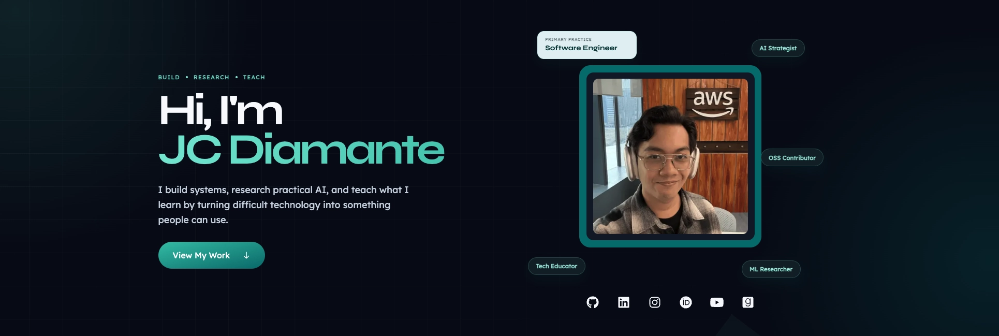

  
  
  
  

Hi, I'm JC, from the Philippines.

I've always liked optimizing things. It started with shaving time and space off algorithms. These days it's the tools and workflows around my work, and the agents that now do part of it.

By day I write backend code at [GCash](https://www.gcash.com). The rest of my time goes to AI that has to run somewhere specific: on a phone, on a laptop, or in healthcare software that can't send patient data to a model. I'm also working through a [master's in AI at UT Austin](https://cdso.utexas.edu/msai).

Outside work, I'm on two community projects. At [SapinSapin](https://www.sapinsapin.ai/), which builds AI for Philippine languages, I train and evaluate Filipino speech-to-text and text-to-speech models. I also lead development for [CultureHub](https://www.culturehub.au/), an events platform for Australia's multicultural communities, with a [team](https://tpp.dataengineering.ph/dep-squads/culture-hub) at Data Engineering Pilipinas.

A few things I believe:

- A small tool that works beats a big promise that doesn't.
- Constraints aren't a reason to wait. My local-model experiments run on a [MacBook Air M1](https://www.jcdiamante.com/blog/stop-waiting-perfect-machine-m1-macbook-air).
- AI should widen the door into this industry, not become another paywall.
- If I figured something out the hard way, I should write it down for the next person.

I write at [jcdiamante.com](https://jcdiamante.com). I also play the kalimba.
